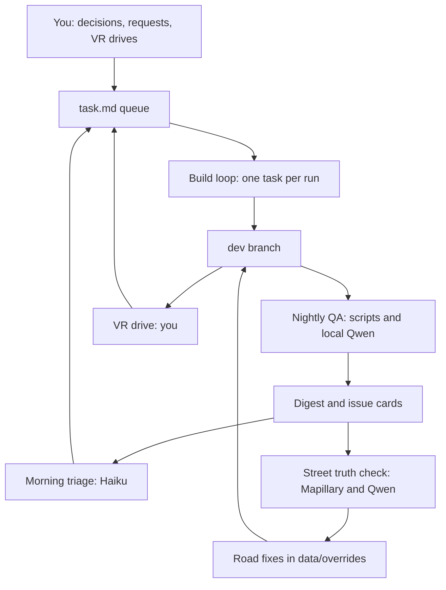

# BeamNG Belfast: how to work on this project

The plan and the work queue are in [task.md](task.md). This guide explains how to run the work, what you do yourself, and how to give it jobs while you are at work.

**The short version.** You make decisions and drive the map in VR. Claude writes the code during the day, one task at a time. BeamNG and the local model test each build overnight without using any Claude tokens. Each morning a cheap model reads the results and updates the queue.

Section 2 works from day one. The rest applies once milestone M0 in `task.md` is done, because M0 builds the commands used below.

## 1. How the loops fit together



| Loop | Starts | Who does the work | Claude usage | Produces |
|---|---|---|---|---|
| Build | Schedule, or you | The model tagged on each task | Medium, one task per run | Code on `dev`, updated `task.md` |
| Nightly QA | 01:00, Windows Task Scheduler | Scripts and local Qwen | None | `DIGEST.md`, issue cards |
| Triage | 06:30 schedule | Haiku 5.5 | Very low | Updated queue, `reports/today.md` |
| Street truth | Part of nightly, once M5 is done | Local Qwen, then Sonnet for fixes | Low | Road fixes with evidence |
| VR review | You, when you have time | You, then Haiku | Very low | Issue cards from your flags |

## 2. First-time setup

This takes about 30 minutes of your attention, spread across a few sittings.

1. Read section 4 of `task.md`. Decide what you want to change, especially decision 1 (test centre) and decision 3 (may the loops push to `dev`).
2. In the Claude desktop app, turn on **Keep computer awake** in Settings. Scheduled tasks only run while the app is open and the PC is awake.
3. Start a new Code session in `H:\Claude\BeamNGBelfast`. Set the model to **Sonnet 5.5** and effort to **high** (Ctrl+Shift+I for model, Ctrl+Shift+E for effort).
4. Paste this, with your own answers filled in:

   ```text
   Read task.md sections 3, 4, 5 and 8, then the M0 table.
   My decisions: test centre = Balmoral. Day job on this PC = yes. Loops may push to dev = yes. Use the defaults for the rest.
   Record those in section 4. Then work through M0 in order.
   For each task: set it to doing, do it, run its Done-when check, set it to done, commit.
   Stop and tell me if a task is tagged "you", if a check fails twice, or if you need to install something T-003 does not list.
   ```

5. When T-010 is finished, ask Claude to do T-011 and check the schedules in section 5 below.
6. Later, before milestone M5, create a Mapillary account and token (T-501). Claude cannot create accounts for you.

**Want to see a rough Belfast tonight?** Go to [mapng.com](https://mapng.com/), select about 2 km around your test centre, export the level, put the zip in BeamNG's `mods` folder and drive it. It needs no install. It shows the unmodified starting point, with no UK-specific work done yet.

## 3. Your week

| When | What you do | Time |
|---|---|---|
| Morning | Read `reports/today.md`. Answer anything marked **Needs you** | 2 minutes |
| At work | Nothing, or send a request from your phone (section 6) | As you like |
| One or two evenings | Deploy the latest good build and drive it in VR (section 4) | 15 to 20 minutes |
| Weekly | Glance at usage in the app and turn the dials in section 8 if needed | 2 minutes |

## 4. The loops in detail

### Build loop

Each run does this:

1. `tools/next_task.py` finds the next ready task. If there is none, the run ends immediately.
2. The dispatcher hands the task to the agent pinned to that task's model and effort.
3. The agent works on a `loop/T-xxx` branch and runs the task's Done-when check.
4. If the check passes, the work merges to `dev` and the status becomes `done`.
5. If it fails twice, the status becomes `blocked` with a note. It then escalates as described in section 5.1 of `task.md`.

Runs at night also take tasks that need the game or the local model. Day runs never launch the game.

### Nightly QA

`qa\nightly.ps1` runs without any LLM session:

1. Builds the current `dev`.
2. Runs static checks. If they fail, it stops here and reports.
3. Launches BeamNG in the throwaway profile with MCP on. Runs surface probes, AI drives and the junction camera sweep.
4. Closes the game and loads Qwen to judge the frames and sort the logs.
5. Unloads Qwen, writes `DIGEST.md` and issue cards, and leaves nothing running.

### Triage

At 06:30 Haiku reads only the digest. It closes fixed issues, adds new tasks to the queue with model tags, and writes `reports/today.md` in under 20 lines.

### Street truth check

Once M5 is done, for each flagged or changed junction:

1. Mapillary photos are paired with a game frame from the same place and heading.
2. Qwen lists differences in lanes, junction control and markings.
3. High-confidence differences become proposed entries in `data/overrides/` with the evidence attached. The rest become issue cards.
4. The junction is rebuilt and checked again.

Google Street View is not part of this loop. Section 2 of `task.md` explains why.

### VR review

1. Say **"deploy the latest passing build to my game"** to Claude. It copies the zip to your normal `mods` folder.
2. Start BeamNG as usual, in VR, and load the level.
3. When something is wrong, press your flag key (set up in T-308). It records the spot and takes a screenshot, so you do not need to remember where you were.
4. Afterwards, add notes to a new file in `feedback/` if you have any, using this template:

   ```text
   Date:
   Build:
   Route or area:
   Comfort, 1 to 5:
   Smooth frame rate? yes or no
   Worst three problems (where, what you expected, what you saw):
   ```

5. Run `/vr-review`. Your flags and notes become issue cards.

## 5. Scheduled tasks

Claude creates these at T-011. Check them in the app's scheduled tasks page. All are local tasks in `H:\Claude\BeamNGBelfast`.

| Name | Schedule | Model | Prompt | Purpose |
|---|---|---|---|---|
| Belfast Day Builder | `0 10,13,16 * * 1-5` | Haiku 5.5 | `/next-task day` | Tasks that need no game |
| Belfast Night Builder | `30 21 * * *` | Haiku 5.5 | `/next-task night` | Tasks that need the game or Qwen. Ends at once if BeamNG is already running |
| Belfast Morning Triage | `30 6 * * *` | Haiku 5.5 | `/triage` | Reads the digest, updates the queue |
| Belfast Weekly Review | `0 10 * * 0` | Opus 5.5 | `/status` then review the plan | Checks direction and model choices |

Haiku is only the dispatcher in the two Builder tasks. Each task still runs on its tagged model.

Nightly QA is separate: T-309 registers `qa\nightly.ps1` in Windows Task Scheduler at 01:00, because it can run for hours and needs no LLM session.

Use **Auto** permission mode for these tasks. T-004's deny rules still apply in that mode. A run that hits a permission prompt waits until you answer it, so a run that looks stuck is usually waiting on you.

## 6. Giving it work while you are at your job

Keep one session named **Belfast control**, on Haiku 5.5. Run `/remote-control` in it once. It then appears in the Claude phone app and at claude.ai/code. The PC does the work and your phone is only a window onto it. The session stays reachable only while the app is running.

Send requests in this form:

```text
Add a task: the mini-roundabout on <road> has the wrong give-way lines.
Done when: the give-way lines match the rule in rules/uk_markings.yaml and G4 passes there.
Priority: next
```

The session adds it to the Inbox table in `task.md` with a model tag, and the next Builder run picks it up.

Other useful messages:

| Say | Effect |
|---|---|
| `status` | A 15-line summary of what is done, running and blocked |
| `start it now` | Runs that task straight away instead of waiting for the schedule |
| `what needs me?` | Lists decisions and tasks tagged `you` |
| `pause the loops` | Turns the schedules off until you say `resume` |

Run `/clear` in this session now and then. Long conversations cost more on every message.

## 7. Which model for what

| Kind of work | Use | Why |
|---|---|---|
| Builds, checks, metrics | A script | Free and repeatable |
| Judging screenshots, comparing photos, sorting logs | Local Qwen, once T-306 has measured it | Free, and high volume |
| Dispatching, triage, tidying docs | Haiku 5.5 | Cheap and quick for routing work |
| Well-scoped coding | Sonnet 5.5, high effort | The everyday default |
| Design, junction geometry, hard cross-system bugs, code review | Opus 5.5, medium to xhigh | Long, difficult reasoning |
| Something Opus at xhigh has failed twice | Fable 5.1 | Most capable and most expensive |

If you pick a model yourself, start with the tag on the task. Raise the effort before you change model. Anthropic's guide says effort is often the better lever.

## 8. Keeping Claude usage low

Most of this is built in:

- Scripts and Qwen handle the heavy, repetitive work.
- Claude reads one task row, not the whole plan, and reads the digest, not raw logs or images.
- Each scheduled run does one task and ends.
- `CLAUDE.md` stays under 200 lines, with details moved to `docs/`.
- The BeamNG MCP is connected only in sessions that need it.
- Agent teams are avoided. Anthropic's docs put them at about seven times the tokens of a normal session when teammates run in plan mode.

Dials you can turn:

| Dial | Default | To spend less | To go faster |
|---|---|---|---|
| Day Builder runs | 3 per weekday | 1 per day | Hourly |
| Frames Qwen can pass to Sonnet | 20 per night | 0 | 50 |
| Weekly Opus review | On | Fortnightly | Leave on |

## 9. The local model

LM Studio is already installed, so nothing else is needed. These are the commands the QA scripts use:

```bash
lms server start --port 1234
```

```bash
lms load qwen/qwen3.8-27b --identifier belfast-vlm --context-length 16384 --ttl 1800
```

```bash
lms unload --all
```

The model takes most of the 4090's 24 GB. QA therefore captures frames first, closes the game, and only then loads the model. T-008 tests whether both can run together.

## 10. When something goes wrong

| What you see | Likely cause | What to do |
|---|---|---|
| A scheduled run looks stuck | It is waiting for a permission prompt | Open that run and answer. Ask Claude to add a narrow allow rule if it recurs |
| No digest this morning | The PC slept, or nightly QA failed | Read `H:\BelfastData\reports\latest\nightly.log` |
| "Game lock held" errors | An earlier run ended badly | Say "clear the game lock", after checking the game is not running |
| Everything broke after a BeamNG update | The game changed | Say "run T-706" |
| Out-of-memory errors | The model and game overlapped | Run `lms unload --all` |
| Builders keep stopping | `dev` is failing its checks | Say "fix dev" in Belfast control |
| Runs fail with usage-limit errors | You reached your plan's limit | Runs resume after the limit resets. Turn the dials down |
| The map feels wrong in VR but all gates pass | A gate is missing something | Flag it and write notes. Each VR finding should end up as an automatic check |

**To stop everything:** turn off the schedules in the app, disable the `BelfastQA` task in Windows Task Scheduler, close any BeamNG window opened by QA, and run `lms unload --all`.
